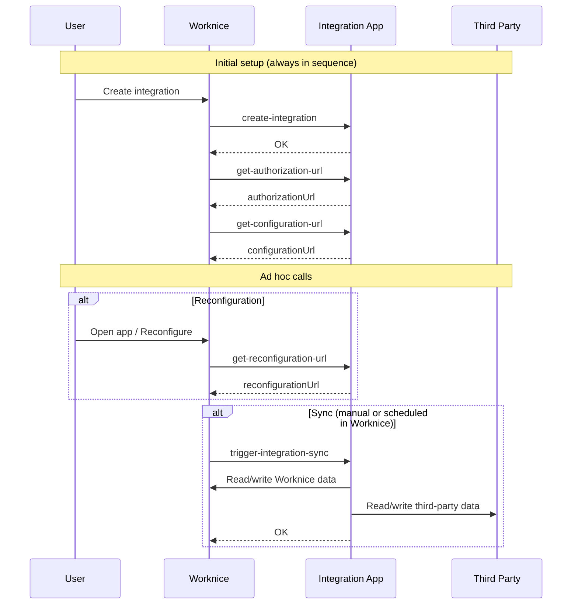

# Slack integration for Worknice

This is the official Slack integration for Worknice which can be added to any
organisation from the app directory.

Features:

- Sync Slack users into Worknice.
- Post daily notifications to Slack about events on the Worknice shared calendar
  (birthdays, work anniversaries and leave periods).
- Post notifications to Slack when new people start.
- Lookup a Worknice person in Slack using a `/whois` slash command in Slack.
- See who is on leave using a `/whosaway` slash command in Slack.

## Deployment

You can deploy your own instance of this app to Vercel by following the steps
below:

1. Fork this repository.

2. Slack configuration:

   1. Create a new Slack app.

   2. Add a `https://«your-app.com»/auth-callback` OAUth redirect URL.

   3. Add a `/whois` slash command that points to `https://«your-app.com»/slack-slash-commands`.

   4. Add a `/whosaway` slash command that points to `https://«your-app.com»/slack-slash-commands`.

3. Worknice configuration:

   1. Create a new "Integration App" in Worknice.

   2. Configure the app with the following details:

      ```
      createIntegration: https://«your-app.com»/worknice-webhooks/create-integration
      getAuthorizationUrl: https://«your-app.com»/worknice-webhooks/get-authorization-url
      getReconfigurationUrl: https://«your-app.com»/worknice-webhooks/get-reconfiguration-url
      triggerIntegrationSync: https://«your-app.com»/worknice-webhooks/trigger-integration-sync
      ```

4. Vercel configuration:

   1. Create a new project in Vercel.

   2. Add an Upstash KV (Redis) database to your account.

   3. Connect the Upstash KV database to your Vercel project. This should set
      the `REDIS_REST_API_TOKEN` and `REDIS_REST_API_URL` environment variables.

   4. Set the remaining environment variables:

      ```bash
      # The URL where your instance is hosted.
      BASE_URL=https://«your-app.com»

      # A secret to secure the Vercel cron jobs (see https://vercel.com/docs/cron-jobs/manage-cron-jobs#securing-cron-jobs).
      CRON_SECRET=xxx

      # Client ID for the Slack app.
      SLACK_CLIENT_ID=xxx

      # Client secret for the Slack app.
      SLACK_CLIENT_SECRET=xxx

      # URL where Slack will redirect after authentication (must match the Redirect URI configuration in Slack).
      SLACK_REDIRECT_URI=https://«your-app.com»/auth-callback

      # The signing secret to secure requests from Slack.
      SLACK_SIGNING_SECRET=xxx
      ```

   5. Redeploy the project so that the environment variables take effect.

## Development

### Prerequisites

- [Node (v20)](https://nodejs.org/en/download/)
- [pnpm](https://pnpm.io/installation)
- [Docker](https://docs.docker.com/get-docker/)

### Getting started

1.  Install dependencies:

    ```
    pnpm install
    ```

2.  Start the background services (Redis instance):

    ```
    pnpm activate
    ```

3.  Start the Next.js app in dev mode:

    ```
    pnpm dev
    ```

    The app will be available at [http://localhost:6100](http://localhost:6100).

### Common tasks

- Tear down the background services (Redis instance):

  ```
  pnpm deactivate
  ```

- Test the TypeScript types:

  ```
  pnpm test:types
  ```

- Connect to the local Redis instance using the `redis-cli`. On macOS, you can
  install it using Homebrew:

  ```
  brew install redis
  ```

  You can connect like this:

  ```
  redis-cli -p 6101 PING
  ```

## How to build a Worknice integration

The easiest way to build an integration is to leverage the [Worknice JS SDK package](https://www.npmjs.com/package/@worknice/js-sdk),
which contains utilities that facilitate interaction between Worknice and the third-party service. Communication is based on
webhooks and events, which Worknice triggers in several stages of the integration lifecycle. The main webhooks an integration can
implement are as follows:

- `create-integration`: called when an instance of the integration is created in Worknice. It receives an integration id and an API token
  the integration can use to make requests back to Worknice.
- `get-authorization-url`: should be implemented in case the integration needs to authenticate/authorise access to the third-party
  service. If implemented, it is called right after `create-integration`.
- `get-configuration-url`: should be implemented if the user needs to do any initial setup in the app and can be used in conjunction
  with `get-authorization-url` to finalise the authorisation process. For example, the Config screen could ask for username and password.
  The webhook must return a valid page URL.
- `get-reconfiguration-url`: should be implemented in case the app supports a page where the user can update/reconfigure app settings.
  Worknice will display an "Open app" link on the integration page in case the webhook is implemented and returns a valid page URL.
- `trigger-integration-sync`: called whenever a manual or scheduled "sync" is triggered in Worknice. It serves to ensure both systems are
  in sync when it comes to people/employee data, and accepts 3 different modes:
  - Two-way: Worknice can update the third-party service and vice-versa based on a "last updated" timestamp
  - Worknice to remote: data from Worknice is sent to the third-party (e.g. a new employee was added)
  - Remote to worknice: data from the third-party is sent to Worknice

The [Mermaid](https://www.mermaidchart.com/) diagram below depicts the sequence of events:



Note that none of the webhooks are mandatory. However, there might be some dependency between them, e.g.
`trigger-integration-sync` will not be able to send data back to Worknice in case `create-integration` is not
implemented because the integration app will not have the required API token.
